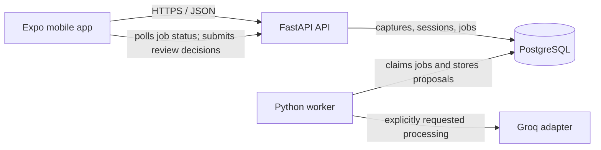

# Aporia

**A private thought-processing app that turns quick captures into organized, reviewable next steps.**

Aporia is a cross-platform mobile app built with Expo and React Native, backed by a Python API and PostgreSQL. Users capture a thought, request an AI proposal when useful, review and edit it, then decide what becomes a saved item. The original capture remains intact unless the user deletes it.

**Capture → Process → Review → Retrieve → Act**

## Product capabilities

- **Fast capture:** Text entry and hold-to-speak capture, with speech recognition provided by the device platform.
- **Human-reviewed AI processing:** An explicit user action queues a proposal; users can edit, accept, or reject it.
- **Durable processing:** A PostgreSQL-backed worker handles jobs, retries transient failures, and avoids duplicate work for the same capture revision.
- **Useful retrieval:** Search captures and saved items with PostgreSQL full-text search; inspect and manage suggested relationships.
- **Daily review:** Triage unfinished captures, failed jobs, and pending suggestions, with priorities and deferral.
- **Data control:** User-scoped records, JSON export, sign-out, and explicit deletion flows.

## Engineering highlights

- **Provider-neutral model boundary:** A Python adapter isolates Groq from processing and persistence logic.
- **Validated model output:** Versioned Pydantic schemas reject unknown fields, oversized proposals, unsupported task evidence, and related-item IDs outside a user-scoped candidate set.
- **Explicit authorization:** The model proposes changes; deterministic backend code checks ownership and applies only the user-approved result.
- **Privacy-aware processing:** Captures and model responses are excluded from operational logs. A processing request sends the selected capture and at most five relevant saved-item candidates (bounded titles and summaries) to the configured model provider; other captures are not included as context.
- **Scoped API and sessions:** The backend verifies Google ID tokens, issues revocable sessions, scopes data access to the authenticated user, and applies request and AI-processing limits.
- **Modular monolith:** API routes, processing jobs, model adapters, validation, and persistence remain separated inside one Python backend.

## Architecture



The API persists processing requests as jobs. A separate worker claims them from PostgreSQL, validates the model proposal, and stores it for review. The mobile client polls job status; accepting a proposal applies only the reviewed changes.

## Technology

| Area | Technology |
|---|---|
| Mobile | Expo, React Native, TypeScript, Expo Router |
| API | Python 3.11+, FastAPI, Pydantic |
| Persistence | PostgreSQL, Psycopg 3, versioned SQL migrations |
| Background processing | PostgreSQL-backed jobs and a separate Python worker |
| Model provider | Groq Python SDK behind a provider adapter |
| Authentication | Native Google Sign-In, server-verified ID tokens, revocable bearer sessions |
| Validation | Pytest, Ruff, ESLint, TypeScript |

## Repository layout

```text
.
├── backend/
│   ├── app/
│   │   ├── agent/    # Processing jobs, prompts, model adapter, routes
│   │   ├── auth/     # Authentication routes
│   │   ├── captures/ # Capture routes
│   │   ├── core/     # Configuration, database, errors, validation
│   │   ├── export/   # Export routes
│   │   ├── items/    # Saved item routes and related item matching
│   │   ├── review/   # Daily review routes
│   │   ├── search/   # Search signals
│   │   ├── main.py   # FastAPI application entry point
│   │   ├── migrate.py
│   │   └── worker.py # Background processing entry point
│   ├── migrations/   # Versioned PostgreSQL migrations
│   └── tests/        # Unit and database integration tests
├── mobile/
│   ├── src/app/      # Expo Router screens
│   ├── src/components/
│   └── src/lib/      # API, session, speech, and export helpers
├── compose.yaml      # Local PostgreSQL service
└── README.md
```

## Run locally

### Requirements

- Python 3.11 or newer
- Node.js and npm
- Docker Compose
- Xcode for iOS builds or Android Studio for Android builds

### Backend

Create the local environment file and start PostgreSQL:

```sh
test -f .env.local || cp .env.example .env.local
docker compose up -d db
```

Set `AUTH_GOOGLE_ID` in `.env.local` to the Google **Web application** OAuth client ID. To enable AI processing, also set `GROQ_API_KEY` and `GROQ_MODEL`. The API can run without Groq configured, but processing requests will be unavailable.

Install dependencies, apply migrations, and start the API:

```sh
cd backend
python3 -m venv .venv
make install-dev
make migrate
make api
```

In a second terminal, run the worker:

```sh
cd backend
make worker
```

The API listens on port `3000`. Its health endpoint is `GET /healthz`.

### Mobile app

Create the mobile environment file:

```sh
cd mobile
npm ci
test -f .env.local || cp .env.example .env.local
```

Set `EXPO_PUBLIC_API_URL` to the backend address reachable from the device:

- iOS simulator: `http://localhost:3000`
- Android emulator: `http://10.0.2.2:3000`
- Physical device: the computer's LAN address

Set `EXPO_PUBLIC_GOOGLE_WEB_CLIENT_ID` to the same Web client ID configured as `AUTH_GOOGLE_ID`. For native Google Sign-In, configure OAuth clients in the same Google Cloud project for bundle/package ID `com.aporia.mobile`; Android also requires the signing certificate SHA-1. Set `EXPO_PUBLIC_GOOGLE_IOS_CLIENT_ID` to the iOS client ID.

Google Sign-In and speech recognition require a native development build; Expo Go is not supported. From `mobile/`, use `npm run android` or `npm run ios` to build and launch on the corresponding local platform. Use `npm start` to start Metro separately when needed. Production API URLs must use HTTPS.

### Checks

```sh
cd backend
make test
make lint
make format-check
```

Database integration tests use a dedicated local database ending in `_test`. Set `APORIA_TEST_DATABASE_URL` before running `make integration-test`.

```sh
cd mobile
npm run lint
npm run typecheck
```

## Privacy and trust boundaries

- Every user-owned API operation is scoped to the authenticated user.
- Google ID tokens are verified by the backend and not retained; Drive access is not requested.
- AI output is an untrusted proposal, validated before it can be reviewed or accepted.
- Captured text is treated as data, not as privileged instructions to the model.
- Voice recordings are not stored by Aporia. Speech recognition is performed by the platform service, which may use network services depending on device settings.
- Export and deletion are explicit user actions.

## Project status

The repository contains the mobile app and backend for local development. Production AWS infrastructure and a public beta deployment are not included yet.
